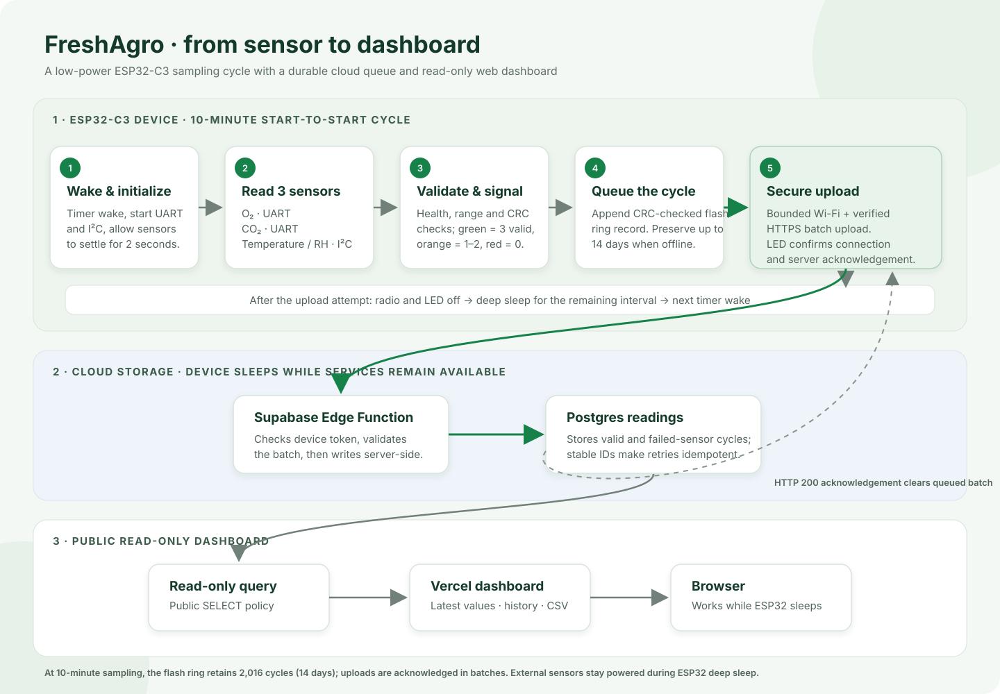
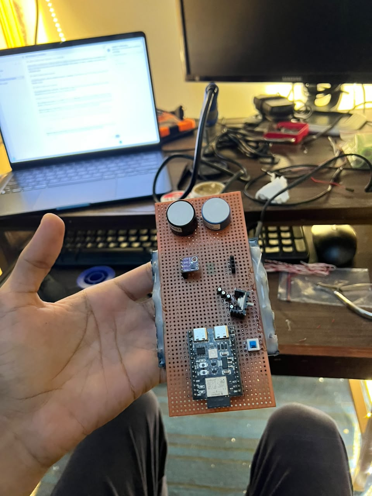
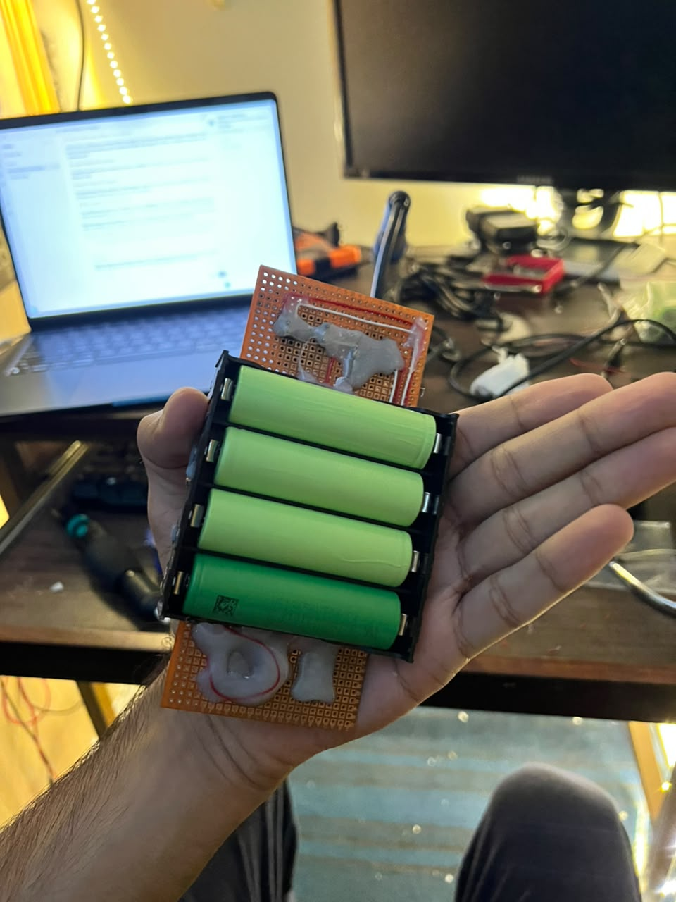

# FreshAgro project handoff

This folder collects the deployable FreshAgro source in one place. The latest cloud firmware identified in the project’s upload and serial-test records is `Arduino/FreshAgro_Cloud/FreshAgro_Cloud.ino`. It is the ten-minute wake/read/upload/deep-sleep sketch with three LED status checks. Its matching headers are beside it. The separately preserved `Arduino/Hardware_Validated/FreshAgro.ino` is the known hardware-only rollback sketch with two-minute readings.

## Project flow

[Open the flow chart notes](docs/PROJECT_FLOW.md).

## Hardware photos

| Sensor and controller side | Battery and reverse side |
|:--:|:--:|
|  |  |

## Project parts

- `Arduino/FreshAgro_Cloud/`: cloud-connected ESP32-C3 firmware. Open the `.ino` in Arduino IDE with ESP32-C3 Dev Module and USB CDC On Boot enabled. Set `readingCycleMinutes` near the top of the sketch to change the interval.
- `Web/`: static Vercel dashboard. Production URL: https://freshagro-bice.vercel.app/
- `Supabase/`: database configuration/migration and authenticated ingestion Edge Function. The Supabase project ref is `ucqfewqkwvmfitkibcvh`.
- `Tests/`: Node tests for dashboard, ingest handler and payload validation.

## Arduino configuration

Copy `Arduino/FreshAgro_Cloud/config.local.example.h` to `config.local.h` in the same sketch directory and fill in your Wi-Fi, ingestion URL, device token, and verified TLS root certificate locally. The raw device token must match the SHA-256 token hash configured as the Supabase Edge Function secret. Do not commit `config.local.h`, Wi-Fi credentials, EAP credentials, device tokens, or service-role keys. `config.h` uses empty safe defaults when the local file is absent.

The sketch scans for eduroam first and authenticates with PEAP when the username, password, server domain, and trusted EAP CA certificate are configured. If NUST supplies no separate CA file, `EAP_CA` can contain PEM certificates exported from a trusted system root store. Keep the `nust.edu.pk` server-domain check enabled. If eduroam is absent, its profile is incomplete, or its connection cannot store a reading, the sketch disconnects, disables enterprise authentication, and tries the configured 2.4 GHz WPA2-Personal backup network (Pie on the tested board). A successful eduroam upload skips Pie. The sensor LED check runs first; the final two LED checks report internet reachability and data storage for the network used on that wake, or for Pie if fallback was attempted. Credentials belong only in the private local configuration.

## Offline queue

The cloud firmware keeps a CRC-checked, fixed-slot queue in the existing SPIFFS partition, with small progress metadata in NVS. The compact ring holds **2,016 readings (14 days at the default 10-minute cycle)**. Faster cycles retain fewer days. A previous, larger ring remains readable while it has pending data and is retired on a later boot after it drains. The older 72-reading NVS queue is migrated on first boot, and its old copy remains until the flash records and metadata are saved. Uploads contain at most 72 samples and send up to four batches per wake. Server HTTP 200 advances the saved queue cursor; unacknowledged records are retried with stable IDs. If the ring fills, the oldest unacknowledged samples expire.

## Supabase deployment

The deployed project is `ucqfewqkwvmfitkibcvh`. The migration in `Supabase/migrations/001_readings.sql` creates the telemetry table with public read-only access. The Edge Function verifies the device token and writes with the server-only service-role key. Keep the service-role key in Supabase secrets only. Deployment notes and a combined function source are in `Supabase/ingest-deploy.ts`.

## Validation and current status

Run the available tests with `node --test Tests/*.test.mjs`. The dashboard is deployed. On 2026-11-20, the ESP32-C3 connected through the 2.4 GHz Pie hotspot, uploaded its saved backlog to Supabase, migrated to the compact ring, and acknowledged a newly captured reading with zero pending records. Supabase contained 1,062 readings after that check. One incomplete old flash record could not be recovered; its raw bytes remain in the private flash backup. The 10-minute battery-input current and a sustained unattended sleep/wake cycle have not been measured/verified.

The board was flashed with the eduroam-first cloud firmware and tested through a physical reset on 2026-11-20. Its PEAP configuration setters returned success, but eduroam did not obtain an IP address within the connection timeout. The board then disabled enterprise mode, connected to Pie, uploaded one new reading (acknowledged through queue order 1009), finished with zero pending records, and showed green for both final LED checks. That test verified fallback only; see the successful primary-network test below. The source and required sketch headers are included here. No private local configuration or compiled firmware binary is included; recreate local settings from the example before uploading.

On 2026-11-23, a source audit found that the EAP CA bundle length omitted the PEM terminating NUL byte required by Mbed TLS. The corrected source includes that byte and checks certificate parsing before connecting. One obsolete MD2-signed root was removed from the private system-root export. The diagnostic build then parsed all 32 remaining roots, verified the eduroam server certificate for `nust.edu.pk` with zero validation flags, obtained an IP address, and uploaded all seven pending readings through queue order 1018. The normal firmware, installed with TLS tracing disabled, subsequently connected to eduroam after one handshake retry and uploaded a fresh reading through order 1019. Both final LED checks were green, Pie was skipped, and the final queue reported zero pending and zero dropped records. Supabase independently confirmed the uploads (1,084 device readings total). The build date supplies a provisional certificate clock until network time is available, eduroam has a 60-second connection window, and the upload time budget starts after Wi-Fi connects. See [eduroam troubleshooting notes](docs/eduroam-troubleshooting.md).
