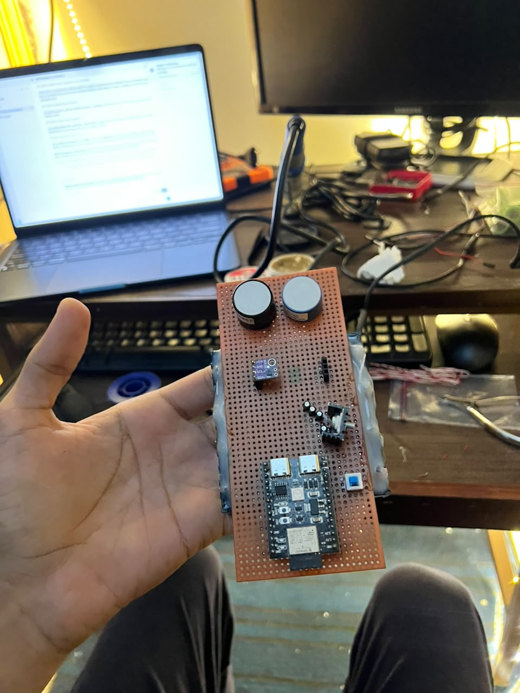
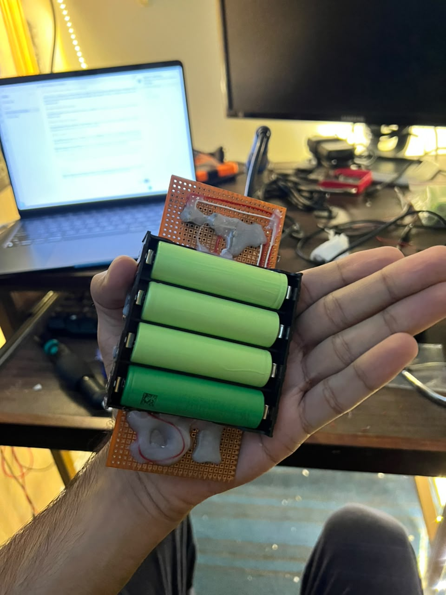

# FreshAgro project handoff

This folder collects the deployable FreshAgro source in one place. The latest cloud firmware identified in the project’s upload and serial-test records is `Arduino/FreshAgro_Cloud/FreshAgro_Cloud.ino`. It is the ten-minute wake/read/upload/deep-sleep sketch with three LED status checks. Its matching headers are beside it. The separately preserved `Arduino/Hardware_Validated/FreshAgro.ino` is the known hardware-only rollback sketch with two-minute readings.

## Project flow

The ESP32 wakes on its timer, samples and validates the three sensors, stores the cycle in its persistent queue, then attempts a bounded secure upload. It returns to deep sleep for the remainder of the ten-minute start-to-start interval. The hosted dashboard reads stored history independently of the device.

See the full [project flow chart](docs/PROJECT_FLOW.md).

## Hardware photos

Sensor and controller side of the prototype:

Battery and reverse side of the prototype:

## Project parts

- `Arduino/FreshAgro_Cloud/`: cloud-connected ESP32-C3 firmware. Open the `.ino` in Arduino IDE with ESP32-C3 Dev Module and USB CDC On Boot enabled. Set `readingCycleMinutes` near the top of the sketch to change the interval.
- `Web/`: static Vercel dashboard. Production URL: https://freshagro-bice.vercel.app/
- `Supabase/`: database configuration/migration and authenticated ingestion Edge Function. The Supabase project ref is `ucqfewqkwvmfitkibcvh`.
- `Tests/`: Node tests for dashboard, ingest handler and payload validation.

## Arduino configuration

Copy `Arduino/FreshAgro_Cloud/config.local.example.h` to `config.local.h` in the same sketch directory and fill in your Wi-Fi, ingestion URL, device token, and verified TLS root certificate locally. The raw device token must match the SHA-256 token hash configured as the Supabase Edge Function secret. Do not commit `config.local.h`, Wi-Fi credentials, EAP credentials, device tokens, or service-role keys. `config.h` uses empty safe defaults when the local file is absent.

The sketch can use WPA2-Personal or WPA2-Enterprise; institution-specific EAP settings and certificates belong only in your private local configuration. Verify those settings before relying on eduroam.

## Supabase deployment

The deployed project is `ucqfewqkwvmfitkibcvh`. The migration in `Supabase/migrations/001_readings.sql` creates the telemetry table with public read-only access. The Edge Function verifies the device token and writes with the server-only service-role key. Keep the service-role key in Supabase secrets only. Deployment notes and a combined function source are in `Supabase/ingest-deploy.ts`.

## Validation and current status

Run the available tests with `node --test Tests/*.test.mjs`. The dashboard is deployed and the project records document a successful HTTPS batch upload and HTTP 200 acknowledgement from the ESP32 over the temporary Pie hotspot, with ten genuine samples visible in Supabase. The 10-minute battery-input current and a sustained unattended sleep/wake cycle have not been measured/verified.

The Arduino cloud sketch is the one recorded as uploaded through Arduino IDE with its flash hash checked. The source and required sketch headers are included here. No private local configuration or compiled firmware binary is included; recreate local settings from the example before uploading.
