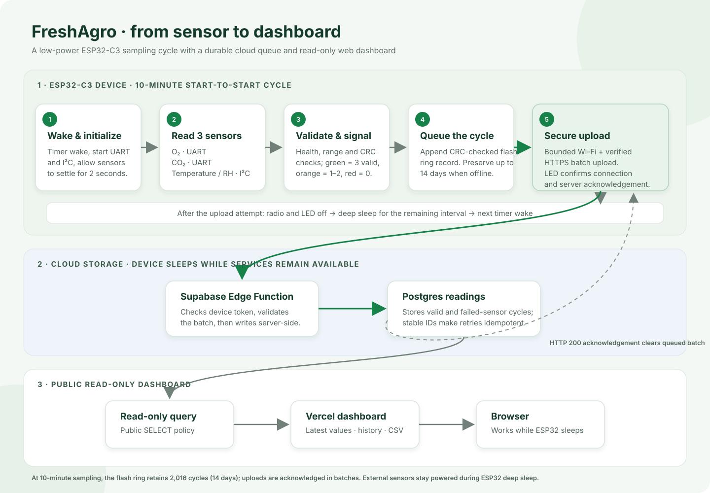

# FreshAgro project flow

The diagram separates the ESP32’s timed sensor cycle, cloud ingestion/storage, and the public read-only dashboard. After reading the sensors, the ESP32 scans for eduroam and uses it when its trusted EAP profile is complete. If eduroam is absent or cannot store a batch, it tries the configured 2.4 GHz personal Wi-Fi backup (Pie on the tested board). The last two LED checks reflect the network used or last attempted. The ESP32 keeps failed uploads in its 14-day SPIFFS ring queue and retries up to four 72-sample batches per wake. A server acknowledgement advances the saved queue cursor only after storage succeeds.

Hardware photos are shown in the root [project README](../README.md#hardware-photos).
