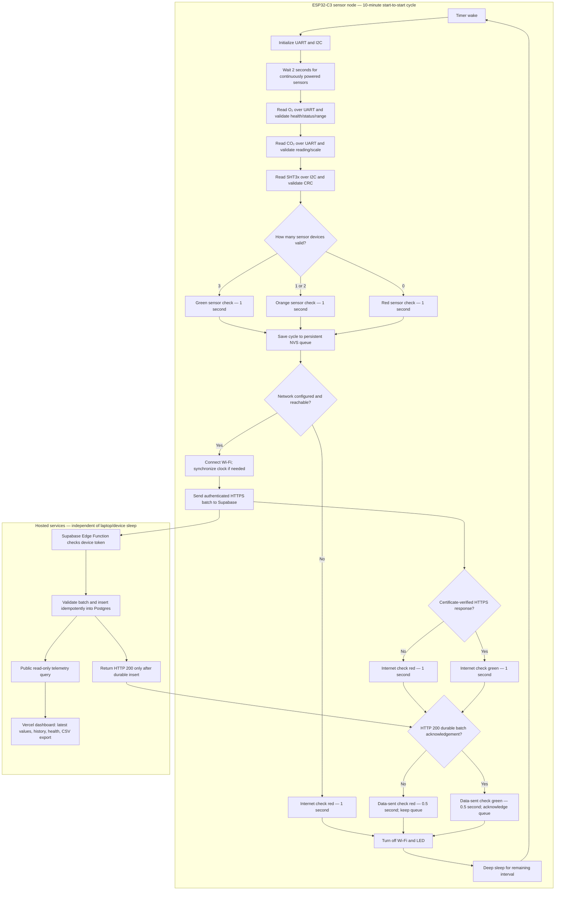

# FreshAgro project flow

The queue retains readings when an upload fails and retries them later. Server-side sample IDs prevent duplicate rows after a lost acknowledgement. The 72-cycle queue, timing and LED outcomes are implemented in the cloud sketch. Sensor supplies remain on; deep sleep alone does not power down the external sensors or board regulator.
