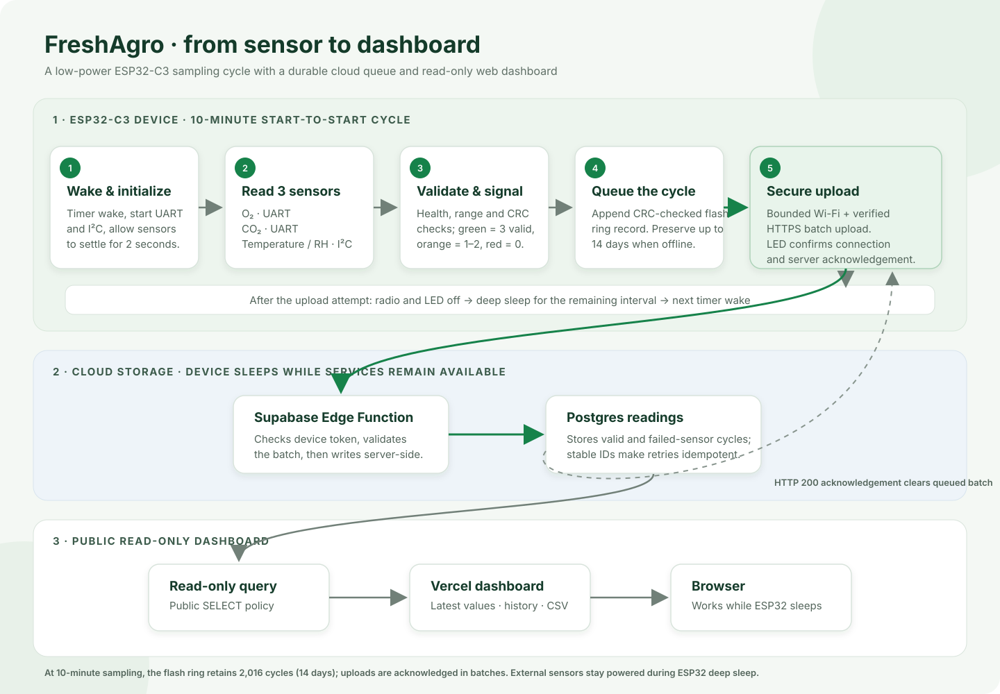

# FreshAgro project flow

The diagram separates the ESP32’s timed sensor cycle, cloud ingestion/storage, and the public read-only dashboard. The ESP32 keeps failed uploads in its non-volatile queue and retries them on a later wake. A server acknowledgement clears the batch only after storage succeeds.

Hardware photos are shown in the root [project README](../README.md#hardware-photos).
